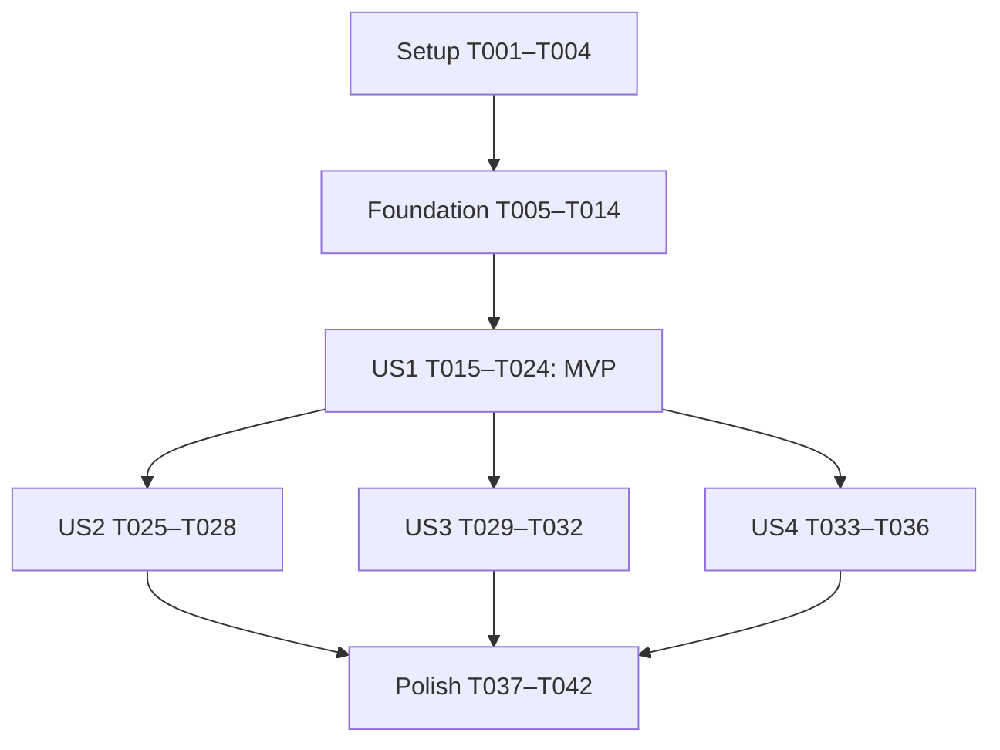

# Tasks: Route Builder — обязательное ядро

**Input**: Утвержденные документы из `specs/001-build-route/`.
**Prerequisites**: [plan.md](plan.md), [spec.md](spec.md), [research.md](research.md),
[data-model.md](data-model.md), [API contract](contracts/api.md),
[UI contract](contracts/ui-state.md), [quickstart.md](quickstart.md), конституция.
**Created**: 2026-10-27. **Branch**: `001-build-route`.

**Tests**: Автотестовый framework и TDD не запрошены и не добавляются. Ручные
приемочные проверки, контрактный smoke и lint/typecheck обязательны по плану;
их результаты записываются при реализации, а не объявляются пройденными сейчас.
**Organization**: Setup → Foundational → четыре user story (все P1) → Polish.
Нумерация фаз отличается от четырех технических фаз plan.md ради законченных
пользовательских срезов; соответствие приведено ниже.

## Format: `[ID] [P?] [Story] Description`

Каждая задача имеет checkbox, уникальный Txxx и точный путь. [US1]–[US4] соответствуют
историям spec.md. [P] разрешает параллельную работу только после завершения
перечисленных предпосылок и в разных файлах; совместные правки одного файла
всегда последовательны. Это не указание автоматически запускать агентов.

## Path Conventions

Все пути относятся к корню репозитория. Источники: App.tsx и src/{config,types,api,
context,screens,components}. Документы проверки: specs/001-build-route/verification.md
(создается при реализации). Структура не требует миграции entry point.
Клиент использует только GET /v1/stops и POST /v1/routes. server.js неизменяем.
Новые возможности вне обязательного ядра не добавляются.

## Phase 1: Setup (Shared Infrastructure)

**Purpose**: Подготовить существующий starter без его повторной инициализации.

- [X] T001 Сверить `package.json`, Node >=22.13.x и strict-настройку `tsconfig.json`; перед кодом прочитать документацию Expo SDK из package.json и связанные страницы из llms.txt, записать версии и ссылки в `specs/001-build-route/verification.md`, не обновляя SDK и не меняя `server.js`.
- [X] T002 Установить `react-native-safe-area-context` через `npx expo install`, проверить совместимость с SDK58 и изменения `package.json` / `package-lock.json`; сохранить существующие runtime-зависимости и entry point `index.ts`.
- [X] T003 Настроить ESLint через Expo CLI и flat config в `eslint.config.js`, фиксируя нужные devDependencies в `package.json` / `package-lock.json`; добиться запуска `npx expo lint` без предложения первоначальной настройки, не добавляя тестовый framework.
- [X] T004 [P] Создать минимальные токены цветов/отступов/типографики в `src/components/theme.ts` по `designs/RouteBuilder-Screens.html`, без копирования демонстрационных контактов/количеств; предусмотреть английский LTR и области нажатия >=44×44.

**Checkpoint**: T001–T004 завершены; toolchain готова, зависимости SDK совместимы.
T002/T003 последовательны, потому что меняют общие package.json/lock.

## Phase 2: Foundational (Blocking Prerequisites)

**Purpose**: Общие типы, транспорт и состояние для всех историй.
Нельзя интегрировать экраны до завершения этой фазы.

- [X] T005 [P] Определить DTO в `src/types/dto.ts` по таблице data-model.md: id — «Непустой стабильный ключ», name/address/phone — string («Не преобразовывать телефон в число»), zone — string, packages_max — «number или string или null» («Строка должна представлять положительное целое»), last_delivery_at — «string или number», notes — «необязательный string или null», items — «StopDto[] или null», числовые page/page_size/total/total_pages и boolean has_more; route stop содержит string stop_id, number packages («JSON number, целое, положительное»), string instructions («Передается без изменения текста»); request.stops — «Непустой уникальный набор», response.id — «Непустой идентификатор созданного маршрута», response.status — «литерал draft»; ApiErrorDto имеет string error, «необязательный Record<string,string>» fields и «необязательные string» request_id/detail.
- [X] T006 [P] Определить Domain и discriminated unions в `src/types/domain.ts`: Stop с packagesMax «number | null», SelectedStop со stop/packages/instructions; mode «one | multi», CatalogueState.status «idle | loading | ready | error», progress «{query: string; nextPage: number; collected: Stop[]} | null»; ApiFailure.kind «network | timeout | http | protocol | cooldown», outcome «rejected | unknown», nullable httpStatus/code/requestId/retryAt и fields Record<string,string>; SubmissionState «idle», «sending», «error», «unknown», «success» с payload из data-model.md; screen «stops | instructions» остается отдельным состоянием App.tsx.
- [X] T007 [P] Создать единственную конфигурацию baseUrl в `src/config/api.ts`: различить LAN-IP для iPhone и localhost симулятора, задать pageSize=50, debounceMs=400, requestTimeoutMs=10000 и fallback Retry-After=2 секунды; не дублировать адрес API в экранах.
- [X] T008 [P] Реализовать декодирование unknown → DTO и Stop в `src/api/decoders.ts` после T005/T006: «null нормализуется в []», packages_max — «положительное безопасное целое», «null сохраняется как отсутствие ограничения»; неверные обязательные поля/максимум дают ProtocolError, неизвестные поля игнорируются, zone/notes/last_delivery_at не переносятся в Domain, пустые строки имени/телефона не превращаются в выдуманные данные.
- [X] T009 [P] Реализовать native fetch в `src/api/client.ts` после T005–T007: JSON/HTTP ошибки, 10-секундный AbortController, очистка таймеров/слушателей в finally, различение отмены GET и таймаута; общий retryAt для 429/503 с секундами/HTTP-date и fallback 2 секунды, без сокращения валидного срока и без автоматических повторов; сопоставить network/timeout/http/protocol/cooldown и не логировать тела с контактами/инструкциями.
- [X] T010 [P] Реализовать listStops(query, options) в `src/api/stops.ts` после T008/T009: GET /v1/stops с URLSearchParams, page с 1 и page_size=50, q.trim() с сохранением регистра; Map по id, короткая/пустая страница или отсутствие новых id завершают обход независимо от total/total_pages/has_more; progress/onProgress сохраняют успешные страницы и nextPage для Retry того же query, иной query начинается с page=1; текущие 24 точки загружаются одним GET.
- [X] T011 [P] Реализовать createRoute(snapshot) в `src/api/routes.ts` после T008/T009: POST /v1/routes с Content-Type application/json и неизмененным текстом; принять только 201, сверить «Snapshot составляется один раз. Ответ сверяется по порядку/id/количеству/тексту», response.status=draft и непустой id; несовпадение/потеря ответа/5xx — unknown с сохранением известного id, 400/422/429 — подтвержденный отказ; никаких автоматических повторных POST.
- [X] T012 [P] Создать валидацию в `src/context/validation.ts` после T006 с точными инвариантами: «selected.length >= 1 для Continue и отправки; one допускает максимум одну точку», «id уникальны; packages — безопасное целое >=1 и <=packagesMax, если он не null», «instructions.trim().length > 0; instructions.length <=200 в единицах UTF-16»; собирать ошибки всех карточек по id, trim использовать только для проверки, не разрезать emoji.
- [X] T013 Реализовать immutable reducer в `src/context/routeBuilderReducer.ts` после T006/T012: начальные «one, []», «packages=1 при добавлении, instructions=""»; уникальные id и порядок выбора, замена в one/снятие в multi, сохранение первой при multi→one, адресные изменения/удаление/Clear all, переходы idle/error/sending/unknown/success; правки не сбрасывают cooldown, повторное добавление удаленной точки начинает ее с 1/пусто, New route очищает черновик и результат, но сохраняет browse-кеш.
- [X] T014 Создать `src/context/RouteBuilderContext.tsx` после T009–T013: Provider/useReducer и типизированные чтения/действия черновика, loadStops и раздельные browse/results, жизненный цикл activeRequestId и progress; состояние хранится вне экранов/строк, список при error не выдается за empty, поздний ответ не меняет состояние, при размонтировании отменяются GET и очищаются таймеры; до T015 выполнить gate §2.1 quickstart.md: запустить существующий starter на целевой iOS, временно подключить Provider в `App.tsx` и получить 24 точки через Context/API с baseUrl из `src/config/api.ts`, записать устройство/ОС/runtime/HTTP-результат в `specs/001-build-route/verification.md`; при блокировке HTTP исправить только необходимую Expo debug-конфигурацию в `app.json`, не начинать экраны до успеха; диагностический вывод убрать при T023, submit подключается в T022.

**Checkpoint**: Общие модули typecheck проходят; api импортирует только config/types,
Context не зависит от экранов, UI не выполняет fetch. Для 24 точек нет второй
страницы и дублей. Значения DTO не подменяют Domain в компонентах.
До T015 обязательно подтверждены запуск starter на целевой iOS и GET из самого
приложения (не только Safari/curl). Ошибка runtime/HTTP блокирует переход к экранам.

## Phase 3: User Story 1 - Создать маршрут одной остановки (Priority: P1) — MVP

**Goal**: Законченный поток One stop → количество → инструкция → подтвержденный маршрут.
**Independent Test**: На iOS выбрать stp_1001, Save=2, написать инструкцию, отправить;
проверить Route created, id и совпадение stops, запрет повторной отправки и New route.
Нельзя демонстрировать MVP без валидации и базовой синхронной защиты отправки.

### Implementation for User Story 1

- [X] T015 [P] [US1] Создать `src/components/StopRow.tsx`: инициалы, имя/адрес/строковый телефон, выбранность и пилюля N×, callbacks выбора/количества, Unknown stop/No phone при пустых значениях, читаемое длинное имя; Domain props, StyleSheet и области >=44×44.
- [X] T016 [P] [US1] Создать `src/components/PackageQuantityModal.tsx`: −/число/+/Save и закрытие без сохранения; локальное временное число, границы «packages — безопасное целое >=1 и <=packagesMax, если он не null», «Save коммитит временное число селектора; Cancel/закрытие не меняет Draft».
- [X] T017 [P] [US1] Создать `src/components/SelectionTray.tsx`: чипы выбранных адресов, горизонтальная прокрутка и Continue (N stops), N — число уникальных точек; «selected.length >= 1 для Continue и отправки», при нуле действие недоступно, без жестко заданных количеств макета.
- [X] T018 [P] [US1] Создать `src/components/InstructionCard.tsx`: имя, N×, адрес, контролируемый TextInput, N/200, Clear all и callback Remove from route; maxLength=200 плюс защита UTF-16/emoji по validation, ошибки по id и disabled props, стандартный StyleSheet без сетевой логики.
- [X] T019 [P] [US1] Создать `src/components/RequestState.tsx` с английскими loading/error/empty/success, props для сообщения/действия/disabled, индикатором отправки и accessibilityLabel/accessibilityState; не отображать raw JSON и не смешивать empty с ошибкой.
- [X] T020 [P] [US1] Создать `src/screens/StopsScreen.tsx` после T015–T017/T019: Context-загрузка полного справочника, SectionList key=id/immutable extraData, английская сортировка и секции без учета регистра, # в конце; выбрать/заменить/снять одну точку, открыть селектор и передать Continue; показать разные loading/error/empty без прямого fetch.
- [X] T021 [P] [US1] Создать `src/screens/InstructionsScreen.tsx` после T018/T019: базовый FlatList карточки выбранной точки, привязка текста/Clear all к Context, N/200, Finish instructions с валидацией и ошибкой, KeyboardAvoidingView и прокрутка; callback отправки/переходов связывается после T022.
- [X] T022 [US1] Подключить submit в `src/context/RouteBuilderContext.tsx` к validation/createRoute: «inFlight ref устанавливается синхронно до await; повторный вызов сразу выходит», неизменяемый snapshot, sending/error/unknown/success, снятие ref в finally и отдельный запрет Submit после success; сохранить черновик при любом отказе, запретить автоматический повтор; уже до T024 действия Context отвергают изменения/выбор/Remove/Clear all при sending, unknown не допускает правок или повтора без явного решения; success не разрешает повтор Submit.
- [X] T023 [US1] Связать `App.tsx`, `src/screens/StopsScreen.tsx` и `src/screens/InstructionsScreen.tsx`: SafeAreaProvider и RouteBuilderProvider выше обоих экранов, screen «stops | instructions» через состояние без новой навигационной зависимости; удалить временный диагностический вывод T014; Back сохраняет ввод; до T024 sending блокирует Back/редактирование/выбор/количество/Remove/Clear all/Submit/New route и визуально, и через Context; unknown сохраняет блокировку правок, success разрешает только просмотр и New route; показать Route created/id только после проверенного 201, New route сбрасывает режим в one/пустой выбор и открывает Stops, сохраняя кеш.
- [X] T024 [US1] Выполнить независимый сценарий US1 по `specs/001-build-route/quickstart.md` на iOS и записать устройство/ОС/runtime, отправленный состав, 201 и сохранность данных в `specs/001-build-route/verification.md`; до объявления MVP проверить пустую инструкцию, быстрые повторные нажатия, весь перечень sending-блокировок T022/T023 и запрет повторной отправки success; непроверенная блокировка не позволяет закрыть MVP, ручной прогон не является unit-тестом.

**Checkpoint**: После T024 имеется безопасный одностопный MVP без зависимости
от US2–US4: все блокировки sending уже реализованы и проверены. Расширенные
UI-повторы/поиск еще не являются завершенными функциями; T034 — регрессия,
а не первая реализация обязательных блокировок.

## Phase 4: User Story 2 - Подготовить несколько остановок (Priority: P1)

**Goal**: Multi-stop route без потери инструкций, с удалением обычной кнопкой.
**Independent Test**: Выбрать три точки, задать разные количества/тексты, очистить
одну, увидеть ошибку только нужной карточки, удалить ее и отправить оставшиеся две;
отдельно проверить Back, multi→one и удаление последней точки.

### Implementation for User Story 2

- [X] T025 [US2] Добавить переключатель One stop/Multi-stop route в `src/screens/StopsScreen.tsx` и связать с reducer: максимум одна точка в one, уникальные точки в multi, повторное нажатие снимает выбор; multi→one сохраняет первую с ее инструкцией/количеством, снятые точки не восстанавливаются автоматически.
- [X] T026 [US2] Завершить многокарточный поток и Remove from route в `src/screens/InstructionsScreen.tsx`: все выбранные точки в порядке выбора, адресные callbacks по id без смещения текста на соседей, удаление обновляет чипы/POST; последняя точка удалена → Stops с недоступным Continue, без дополнительного экрана.
- [X] T027 [US2] Связать errorsByStopId и прокрутку к первой невалидной карточке в `src/screens/InstructionsScreen.tsx`: «Submit проверяет все карточки, сохраняет ошибки по id и показывает первую ошибку», ошибка каждой пустой/пробельной инструкции исчезает после исправления, Clear all меняет только свою инструкцию, остальные поля сохраняются.
- [X] T028 [US2] Завершить привязку нескольких чипов/количеств и переходов в `src/screens/StopsScreen.tsx` и `App.tsx`: N — число точек, не сумма посылок; проверка US2 с отдельным результатом в `specs/001-build-route/verification.md` подтверждает сохранение порядка, текстов и количеств после Back/Continue/смены режима/удаления.

**Checkpoint**: US2 проверяется отдельным многоточечным сценарием на базе US1;
удаление/очистка одной карточки не меняет данные других.

## Phase 5: User Story 3 - Найти точку и восстановиться после сбоя (Priority: P1)

**Goal**: Серверный q-поиск с правильной пустотой, сохранением выбора и защитой от гонок.
**Independent Test**: North Cafe → запрос без совпадений → очистка; быстрые смены q
с обратным порядком ответов и повтор после 500/503/429 не теряют выбор.

### Implementation for User Story 3

- [X] T029 [US3] Добавить search(q) в `src/context/RouteBuilderContext.tsx`: 400 мс debounce, q.trim() без lowercasing, отмена старого GET и проверка activeRequestId для data/status/error/onProgress, «Устаревший requestId не обновляет ни results, ни status, ни error»; отдельный browse-кеш восстанавливается при очистке, выбор и инструкции не сбрасываются.
- [X] T030 [P] [US3] Добавить управляемую строку поиска и Search by name, street, or phone в `src/screens/StopsScreen.tsx` после T029: выдача только сервиса, регистрозависимые имя/адрес и телефон по >=3 цифрам q; No stop found для items=null/[], очистка возвращает полный список и сохраняет чипы.
- [X] T031 [P] [US3] Расширить `src/components/RequestState.tsx` после T029 отдельными сообщениями пустого справочника/пустого поиска, ошибки/ожидания Retry-After и доступным Retry callback, сохраняя различимость empty/error/loading; не превращать неуспешную страницу в пустой результат и не показывать raw JSON.
- [X] T032 [US3] Завершить ручное возобновление загрузки и интеграцию T031 в `src/context/RouteBuilderContext.tsx` / `src/screens/StopsScreen.tsx`: «При ошибке Retry продолжает nextPage; новый query сбрасывает progress и начинает page=1», не принимать progress старого requestId, соблюдать общий cooldown новым q; записать отдельный прогон поиска/ошибки/очистки/гонки в `specs/001-build-route/verification.md`.

**Checkpoint**: US3 проверяем через Stops независимо от создания нового маршрута;
готовые US1/US2 не теряют данные при поиске.

## Phase 6: User Story 4 - Отправить без дублей и потери данных (Priority: P1)

**Goal**: Завершить UI восстановления после сбоев и доказать безопасность отправки.
Базовый lock уже обязателен в US1/T022; эту фазу нельзя использовать как повод
отложить защиту double-tap до конца реализации.
**Independent Test**: На заполненном черновике проверить повтор после подтвержденного
отказа, cooldown, потерю ответа и несовпадающий 201; данные сохраняются, скрытых POST нет.

### Implementation for User Story 4

- [ ] T033 [US4] Реализовать UI unknown/подтверждения Retry в `src/screens/InstructionsScreen.tsx`: «unknown → sending: только после предупреждения и явного подтверждения Retry», сообщить о возможном уже созданном маршруте; отмена оставляет snapshot/ошибку, повтор не обещает exactly-once; не показывать успех по одному HTTP-коду без сверки ответа.
- [ ] T034 [US4] Провести регрессионную проверку уже реализованных в T022/T023 блокировок в `App.tsx`, `src/screens/StopsScreen.tsx`, `src/screens/InstructionsScreen.tsx` после добавления Multi-stop и поиска: sending запрещает Back/редактирование/выбор/количество/Remove/Clear all/Submit/New route; unknown сохраняет блокировку правок до явного решения, success разрешает просмотр и только New route; устранить регрессии и проверить защиту через Context, а не только disabled кнопок. Первая реализация этих блокировок обязательна до T024.
- [ ] T035 [P] [US4] Завершить countdown и доступность Retry в `src/components/RequestState.tsx`: remaining вычисляется от абсолютного retryAt и текущего времени, после возврата приложения учитывается прошедшее время; обработать серверный срок и fallback, снять таймеры при размонтировании, callback не вызывается автоматически при нуле.
- [ ] T036 [US4] Связать исправляемые 400/422/fields.stops, 429 и неизвестные исходы с сообщениями и Retry в `src/screens/InstructionsScreen.tsx` и `src/context/RouteBuilderContext.tsx`: изменение данных не сбрасывает cooldown, после подтвержденного отказа сохраняется ввод, непроверяемый 201 сохраняет receivedRouteId, автоматического POST нет; записать независимую приемку US4 в `specs/001-build-route/verification.md`.

**Checkpoint**: Сбой не сбрасывает черновик и не создает скрытый повтор; response
snapshot/routeId не смешиваются с новым черновиком. Новая попытка после unknown
может дать дубль на сервере — UI предупреждает, не обещая отсутствующей гарантии.

## Phase 7: Polish & Cross-Cutting Concerns

**Purpose**: Завершить обязательную доступность, документацию и приемку всего ядра.

- [ ] T037 Довести `src/screens/StopsScreen.tsx`, `src/screens/InstructionsScreen.tsx` и `src/components/InstructionCard.tsx` по макету в обязательном скоупе: английский LTR без глобальной смены направления устройства, safe area, клавиатура/прокрутка/footer, длинные адреса и Dynamic Type, accessibilityLabel/accessibilityState и области >=44×44; проверить стоя одной рукой.
- [ ] T038 Проверить зависимости и диагностику в `src/api/client.ts`, `src/context/RouteBuilderContext.tsx` и `src/screens/`: UI не вызывает fetch и не знает DTO, api не импортирует Context/UI, не логируются контакты/инструкции/raw JSON; в `specs/001-build-route/verification.md` зафиксировать отсутствие изменений `server.js`, дополнительных операций API и непредусмотренных runtime-библиотек.
- [ ] T039 [P] Документировать в `README.md` точные шаги запуска по `specs/001-build-route/quickstart.md`: Node/установка, node server.js, npx expo start, единственный `src/config/api.ts`, LAN-IP iPhone/localhost симулятора, целевая iOS; использовать уже полученные в T014 результаты runtime/HTTP и необходимые настройки `app.json`, не откладывать первичную проверку подключения до этой задачи.
- [ ] T040 Выполнить contract smoke §3 `specs/001-build-route/quickstart.md` на свежем неизмененном `server.js` и записать команды/ответы в `specs/001-build-route/verification.md`: 24 уникальные точки/ложные метаданные/null-поиск/регистр, отдельный POST с `--data '{'` дает 400 malformed_json, пустой stops дает 422, валидный запрос — 201; проверить детерминированные 500/503 и 429 с Retry-After, без подмены сервера; не считать этот прогон доказательством поведения UI.
- [ ] T041 Пройти SC-001–SC-009 на iOS по `specs/001-build-route/quickstart.md` и записать результаты в `specs/001-build-route/verification.md`: количества/200–201/emoji/пробелы/удаление/Back/сеть; для воспроизводимой ручной инъекции ошибок подготовить временный Node-прокси `/private/tmp/route-builder-fault-proxy.cjs` только на встроенных модулях по точной спецификации §4.1 quickstart.md, выполнить режимы reorder/rate-limit/unavailable/malformed/mismatch/slow-create/lost-create; приложение по-прежнему вызывает только два штатных endpoint через временный baseUrl, после проверки вернуть порт 4000; 20 прогонов десяти быстрых нажатий должны давать один POST каждый, подтвердить счетчиком прокси и Network inspector; SC-001 требует 5 участников, непроведенное измерение честно отметить, не объявляя приемку полностью пройденной. Прокси — временный ручной стенд, не часть клиента/сервера и не новый автотестовый framework.
- [ ] T042 Запустить `npx expo lint` и `npx tsc --noEmit`, устранить ошибки только в клиентских файлах/конфигурации из плана и сохранить фактические результаты в `specs/001-build-route/verification.md`; сверить покрытие FR-001–FR-019 и SC-001–SC-009, перечислить оставшиеся ограничения, не отмечать непроверенные задачи выполненными.

**Checkpoint**: Готовность подтверждается отчетом фактических проверок; отсутствие
участников/устройства/инструмента воспроизведения ошибки не заменяется выдуманным PASS.

## Dependencies & Execution Order

### Phase Dependencies

Все истории P1; рекомендуемый последовательный порядок соответствует файлу.
US2/US3/US4 логически опираются на готовый US1, но имеют отдельные приемочные
сценарии. Их UI меняет общие файлы: не запускать целые истории параллельно.

### User Story Dependencies

| История | Предпосылки | Законченный результат |
|---|---|---|
| US1 | Setup + Foundation | Одностопный E2E, базовая валидация/lock/успех |
| US2 | US1; для проверки поиск не нужен | Несколько точек, правки и удаление без потери данных |
| US3 | US1; US2 не требуется | Справочник/поиск и восстановление загрузки |
| US4 | US1; проверить без необходимости поиска | Полный UI ручных повторов/unknown и блокировок |

### Within Each User Story

- Сначала типы/общий транспорт Foundation, затем независимые компоненты, интеграция,
  и только потом ручная приемка истории.
- До T015 завершить runtime/HTTP gate T014; T024 требует всех блокировок T022/T023.
- T020/T021 — после T015–T019; T022 — после Foundation; T023 — после T020–T022.
- T025–T028 последовательны; T029 предшествует T030/T031, T032 — после обоих.
- T033/T034 последовательны; T035 работает в другом файле и может идти вместе с T034;
  T036 — после T033–T035.
- Подтвержденный дефект исправляется до отметки выполнения соответствующей задачи.

### Parallel Opportunities

- Setup: T004 после T001 можно выполнять отдельно от последовательных T002/T003.
- Foundation: T005/T006/T007 — независимые файлы; T008/T009 — после типов/config;
  T010/T011 — после decoder/client; T012 после T006 может идти отдельно от API;
  reducer/provider требуют завершения перечисленных предпосылок.
- US1: T015–T019 — независимые компоненты; затем T020/T021 — разные экраны.
- US2: безопасной параллельной пары реализации нет: общие экраны и переходы.
- US3: T030 и T031 — разные файлы после T029; T032 интегрирует результаты.
- US4: T034 и T035 — разные файлы после T033; T036 интегрирует результаты.
- Polish: T039 пишет README.md; выполнять после T037/T038 отдельно от инструментальных
  проверок, не меняя verification.md одновременно из нескольких задач.

## Parallel Example: User Story 1

После Foundation: T015 StopRow.tsx, T016 PackageQuantityModal.tsx,
T017 SelectionTray.tsx, T018 InstructionCard.tsx, T019 RequestState.tsx могут
выполняться независимо. После их готовности — T020 StopsScreen.tsx и
T021 InstructionsScreen.tsx. T023 ждет оба экрана и T022 submit.

## Parallel Example: User Story 2

Выполнять T025 → T026 → T027 → T028 последовательно. Общие файлы и зависимость
удаления/ошибок от списка не позволяют честно пометить эти задачи [P].

## Parallel Example: User Story 3

После T029: T030 меняет только StopsScreen.tsx, T031 — только RequestState.tsx;
затем T032 связывает UI и возобновление страниц в Context.

## Parallel Example: User Story 4

После T033: T034 проверяет регрессии блокировок переходов/правок в App.tsx и экранах, T035 добавляет
countdown в RequestState.tsx. После обоих T036 связывает ошибки/Retry в UI/Context.

## Implementation Strategy

### MVP First (User Story 1 Only)

Завершить Setup + Foundation + US1 (T001–T024). Проверить отдельный рабочий поток
на iOS с двумя посылками и валидной инструкцией. Это минимальная демонстрация,
а не объявление всего обязательного ядра завершенным.

### Incremental Delivery

1. US1 — безопасный вертикальный срез двух экранов и создания маршрута.
2. US2 — несколько остановок, удаление, адресная валидация и сохранение.
3. US3 — серверный поиск и устойчивость списка.
4. US4 — законченные действия восстановления отправки.
5. Polish — весь обязательный скоуп и отчет фактической приемки.

### Соответствие техническим фазам plan.md

| Фаза plan.md | Задачи |
|---|---|
| Phase 1: базовый слой | T001–T014, базовый submit T022 |
| Phase 2: пикер | T015–T017, T019–T020, T025, T028–T032 |
| Phase 3: инструкции | T018, T021, T026–T027, часть T023/T037 |
| Phase 4: отправка | T011, T022–T024, T033–T036, T040–T042 |

### Покрытие требований

| Требования spec.md | Основные задачи |
|---|---|
| FR-001 | T001, T020–T023, T037, T041 |
| FR-002–FR-004 | T008–T010, T020, T029–T032 |
| FR-005–FR-007 | T013, T015–T017, T020, T025, T028 |
| FR-008–FR-011 | T012–T014, T018, T021, T026–T027 |
| FR-012–FR-015 | T011–T014, T022–T023, T033–T036 |
| FR-016 | T004, T015–T019, T021, T023, T037 |
| FR-017–FR-019 | T007–T011, T029–T036, T038, T040–T042 |
| SC-001–SC-009 | T024, T028, T032, T036, T040–T042 |

## Notes

- Всего 42 задачи: Setup 4, Foundation 10, US1 10, US2 4, US3 4, US4 4, Polish 6.
- Все 19 FR и 9 SC обязательного ядра имеют задачи/проверки; новых требований нет.
- Источники приложения, сервер и утвержденные дизайн-документы этим этапом
  не изменяются; создается только tasks.md.
- Не ставить [x] за создание артефакта или планирование: задача завершается
  после реализации и применимых проверок. Критерии SC не ослабляются задним числом.
- Следующий шаг процесса — $speckit-analyze для проверки spec/plan/tasks перед реализацией.
